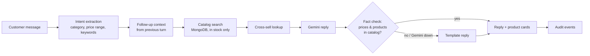
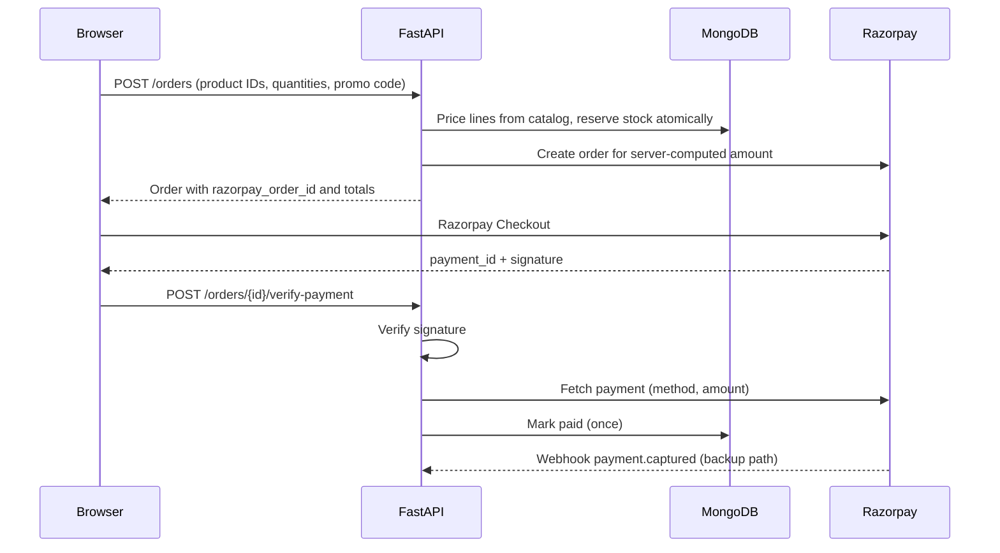

# AI Growth & Agentic Commerce

A conversational shopping assistant (**Nexus**) and merchant dashboard built with FastAPI, React, MongoDB, Gemini and Razorpay Test Mode.

A customer describes what they want, for example *"lightweight running shoes under ₹3,000 with good cushioning"*. The agent searches the real catalog, recommends an in-stock product, suggests a matching accessory, and hands off to Razorpay Checkout. Prices, stock and discounts always come from the database, and every step is written to an audit log.

## Features

**Shopping agent**
- Extracts category, price range (`under 3k`, `between 1000 and 2000`, `2-3k`) and feature keywords from the message
- Understands follow-ups such as *"something cheaper"* or *"a more premium one"* using the previous turn
- Searches MongoDB for in-stock products and ranks them by keyword match and rating
- Suggests a cross-sell; when the merchant has linked it to the product, buying both saves ₹150 per unit at checkout (the chat shows the exact saving)
- Gemini writes the reply; a fact check rejects a reply that quotes a rupee amount that isn't a catalog price (or the customer's own budget), or that names none of the returned products, and falls back to a template reply
- The decision inspector shows what was extracted, how many products matched, and how many of the customer's constraints the top pick meets

**Checkout**
- The browser sends only product IDs and quantities; the server prices every line and computes bundle savings and promo discounts
- Stock is reserved atomically when the order is created and held for 15 minutes (max 20 units per order); unpaid orders expire and release it. Reopening checkout with the same cart reuses the open order
- Payment is confirmed by Razorpay signature verification plus a server-side fetch of the payment (method and amount), and by a webhook if the customer closes the tab
- Promo codes from active campaigns are redeemable at checkout

**Merchant tools** (protected by a merchant key)
- Inventory: add, edit and delete SKUs, adjust stock, low-stock counts, inventory value
- Campaigns: Gemini drafts WhatsApp and SMS copy with a unique promo code; activating a draft makes the code redeemable. Messages are not sent from the app.
- Audit ledger: every agent turn, recommendation, order, payment and fact check, with GMV, checkout completion rate, AI conversion and average agent turn time

## How a chat turn works



## Payment flow



## Tech stack

| Layer | Technology |
| --- | --- |
| Frontend | React 19, TypeScript, Vite, Tailwind CSS 4, TanStack Query |
| Backend | FastAPI, Pydantic 2, Motor (async MongoDB) |
| AI | Google Gemini via `google-genai` |
| Payments | Razorpay Standard Checkout (Test Mode) |
| Tests | pytest, httpx, mongomock-motor; GitHub Actions CI |

## Project structure

```
backend/
  main.py              App, CORS, reservation-expiry loop
  seed.py              Sample catalog, orders, campaigns (all fictional)
  lib/
    intent.py          Category, price range and keyword extraction
    guardrails.py      Fact check for Gemini replies
    pricing.py         Server-side pricing, bundle and promo discounts
    inventory.py       Atomic stock reservation and release
    auth.py            Merchant key check
    audit.py           Audit event helper
    gemini_client.py   Gemini wrapper
    razorpay_client.py Lazy Razorpay client
  models/              Pydantic models
  routers/             agent, catalog, orders, campaigns, audit
  tests/
frontend/
  src/components/      AIChat, Checkout, Merchant, Audit, pages
  src/lib/api.ts       Fetch wrapper (adds the merchant key)
  src/types/
```

## Getting started

### Prerequisites

- Python 3.10+
- Node.js 20+ and npm
- MongoDB (local) or a MongoDB Atlas connection string
- A Razorpay account in Test Mode, and optionally a Gemini API key

### 1. Backend

```bash
git clone https://github.com/prernaranjan1/AI-Growth-Agentic-Commerce.git
cd AI-Growth-Agentic-Commerce/backend

python -m venv venv
source venv/bin/activate          # Windows: venv\Scripts\activate

pip install -r requirements.txt
cp .env.example .env              # Windows: copy .env.example .env
```

Fill in `.env`:

| Variable | Purpose |
| --- | --- |
| `MONGO_URL`, `DB_NAME` | MongoDB connection |
| `CORS_ORIGINS` | Frontend origin, e.g. `http://localhost:5173` |
| `MERCHANT_API_KEY` | Any long random string; unlocks the merchant tabs |
| `RAZORPAY_KEY_ID`, `RAZORPAY_KEY_SECRET` | Razorpay Test Mode keys |
| `RAZORPAY_WEBHOOK_SECRET` | Optional; needed for the webhook |
| `GEMINI_API_KEY` | Optional; without it the agent uses template replies |

Seed the database and start the API:

```bash
python seed.py
uvicorn main:app --reload
```

The API runs at http://localhost:8000, with interactive docs at http://localhost:8000/docs.

### 2. Frontend

```bash
cd ../frontend
npm install
cp .env.example .env              # set VITE_RAZORPAY_KEY_ID to your test key ID
npm run dev
```

Open http://localhost:5173. To use Inventory, Campaigns or Audit, enter your `MERCHANT_API_KEY` when prompted. It is kept for the browser tab only.

### 3. Razorpay webhook (optional)

The webhook marks an order paid even if the customer closes the tab before the browser callback runs. In the Razorpay Dashboard, add a webhook for `payment.captured` and `payment.failed` pointing to `https://<your-public-url>/api/orders/webhook/razorpay`, and put its secret in `RAZORPAY_WEBHOOK_SECRET`. For local testing, expose port 8000 with a tunnel such as ngrok.

In Test Mode, pay with the test cards or UPI IDs listed in Razorpay's documentation; no real money moves.

## Running tests

```bash
cd backend
pip install -r requirements-dev.txt
python -m pytest
```

The tests run against an in-memory MongoDB with Razorpay network calls stubbed. They cover server-side pricing (client prices are ignored), bundle and promo rules, overselling, reservation expiry, signature and amount checks, the webhook, merchant auth, intent extraction, follow-up turns and the reply fact check.

CI runs the backend tests and the frontend type check and build on every push.

## API overview

| Method | Path | Access |
| --- | --- | --- |
| `POST` | `/api/agent/chat` | Public |
| `GET` | `/api/agent/sessions/{id}` | Public (random session ID) |
| `GET` | `/api/agent/sessions` | Merchant |
| `GET` | `/api/catalog`, `/api/catalog/{id}` | Public |
| `POST` `PUT` `DELETE` | `/api/catalog...`, `GET /api/catalog/stats/summary` | Merchant |
| `POST` | `/api/orders` | Public |
| `POST` | `/api/orders/{id}/verify-payment` | Public (signature-checked) |
| `POST` | `/api/orders/webhook/razorpay` | Razorpay (signature-checked) |
| `GET` | `/api/orders`, `/api/orders/{id}` | Merchant |
| `*` | `/api/campaigns...` | Merchant |
| `GET` | `/api/audit/logs`, `/api/audit/metrics` | Merchant |

Merchant endpoints expect the `X-Merchant-Key` header.

## Known limitations

- Intent extraction is rule-based. Moving it to Gemini function calling, with an evaluation set of shopping queries, is the next planned step.
- Search is keyword-based; there is no semantic or vector search yet.
- Tax (GST) is not calculated.
- Campaigns are drafted, not sent; there is no WhatsApp or SMS integration.
- The merchant key is a single shared secret, suitable for a demo, not for multiple merchants.
- Order creation is not rate-limited, so a public deployment should add rate limiting in front of `POST /api/orders` to stop stock being held by spam.
- The fact check catches invented prices and replies about the wrong products; it can't detect an extra invented product name mentioned alongside a real one.
- Seed data (products, brands, customers, orders and campaign metrics) is fictional.

## Screenshots

<details>
<summary>Show screenshots</summary>


</details>

## Author

**Prerna Ranjan**, IT undergraduate and full-stack developer
